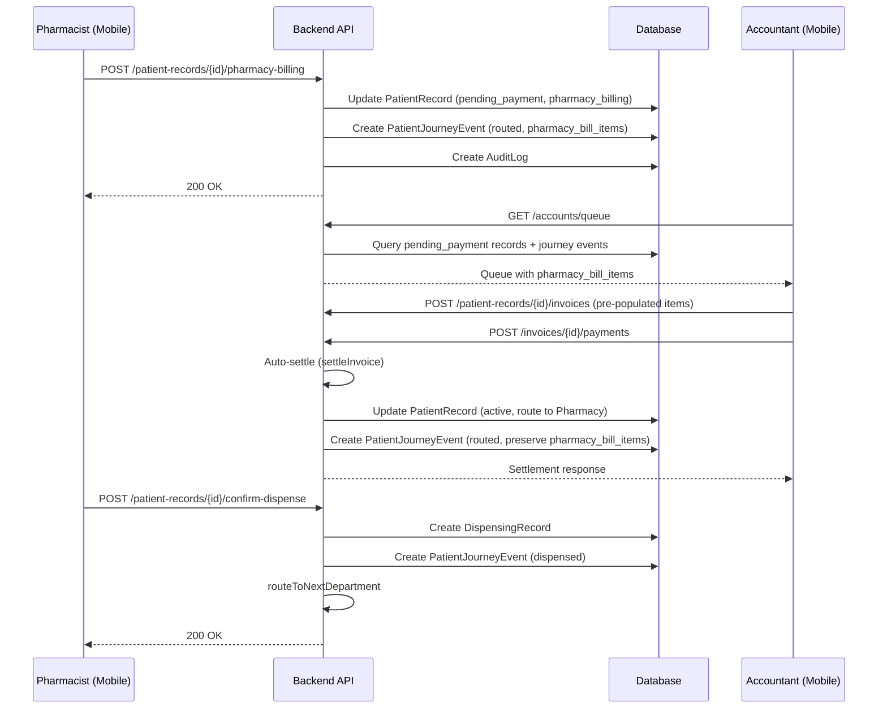
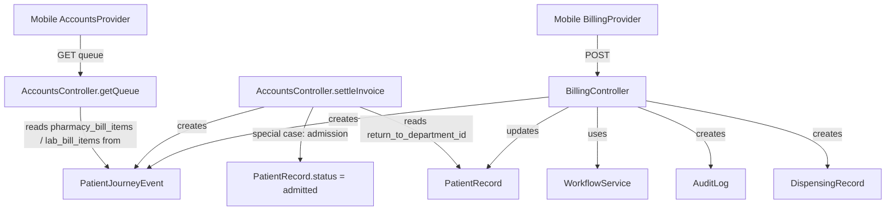

# Design Document: Pharmacy, Lab, and Admission Billing

## Overview

This feature formalises three billing workflows in the hospital management system: **Pharmacy Billing**, **Lab Investigation Billing**, and **Admission Billing**. Each workflow follows the same pattern:

1. A clinical staff member (pharmacist, lab technician, or doctor) submits a billing request with line items.
2. The system sets the `PatientRecord` to `pending_payment`, stores the bill items in a `PatientJourneyEvent` metadata, and routes the patient to the Accounts department.
3. The Accountant creates an invoice (pre-populated from the stored bill items), records payment, and the system auto-settles.
4. On settlement, the patient is routed back to the originating department (or to the ward for admissions).
5. The pharmacist confirms dispense; the lab technician enters results.

The system is a multi-tenant Laravel 11 backend (JWT auth, tenant-scoped models) with a Flutter/Riverpod mobile app.

### Key Design Decisions

- **New endpoints** are added to `PatientRecord` routes: `POST /pharmacy-billing`, `POST /lab-billing`, and the existing `POST /admit` is updated to support `admission_billing` context.
- **Bill items are stored in `PatientJourneyEvent.metadata`** (existing JSON column) under keys `pharmacy_bill_items`, `lab_bill_items`. This avoids new tables and keeps the billing trail in the journey history.
- **The existing `AccountsController::settleInvoice`** already handles `return_to_department_id` routing. The admission billing path adds a special case: status becomes `admitted` and the journey event type becomes `admitted` instead of `routed`.
- **Dispense detection** in the mobile app: a patient in the pharmacy queue with a settled invoice whose most recent billing journey event has `pending_payment_context == pharmacy_billing` gets a "Confirm Dispense" button instead of "Bill Drugs".
- **A new `BillingController`** handles the three new billing endpoints, keeping `DepartmentController` and `ClinicalController` focused on their existing responsibilities.

---

## Architecture



### Component Interaction



---

## Components and Interfaces

### Backend: New `BillingController`

**File:** `backend/app/Http/Controllers/Api/V1/BillingController.php`

Handles three new endpoints. Injected with `WorkflowService`.

#### `POST /api/v1/patient-records/{id}/pharmacy-billing`

**Role:** `pharmacist`

**Request body:**
```json
{
  "items": [
    { "drug_name": "Amoxicillin 500mg", "unit_price": 250.00, "quantity": 2 }
  ]
}
```

**Behaviour:**
1. Validate: `items` array non-empty; each item has `drug_name` (string, max 255), `unit_price` (numeric, > 0), `quantity` (integer, >= 1).
2. Find the Accounts department for the tenant (by `type = 'accounts'` or by name lookup — same approach as existing `route` endpoint).
3. Update `PatientRecord`: `status = pending_payment`, `pending_payment_context = pharmacy_billing`, `return_to_department_id = user->department_id` (pharmacy dept).
4. Create `PatientJourneyEvent`: `event_type = routed`, `from_department_id = pharmacy`, `to_department_id = accounts`, `metadata = { pharmacy_bill_items: [...] }`.
5. Create `AuditLog`: `action = pharmacy_billing.submitted`.
6. Return updated `PatientRecord`.

**Error responses:**
- `422 VALIDATION_ERROR` — missing/invalid items.
- `404 NOT_FOUND` — patient record not found.
- `409 CONFLICT` — patient already has `pending_payment` status.

#### `POST /api/v1/patient-records/{id}/lab-billing`

**Role:** `lab_technician`

**Request body:**
```json
{
  "items": [
    { "test_name": "Full Blood Count", "unit_price": 1500.00, "quantity": 1 }
  ]
}
```

**Behaviour:** Symmetric to pharmacy billing. Sets `pending_payment_context = lab_billing`, stores `lab_bill_items` in journey event metadata.

#### `POST /api/v1/patient-records/{id}/admit` (updated)

**Role:** `doctor`

**Request body:**
```json
{
  "ward_department_id": "uuid-of-ward-department"
}
```

**Behaviour:**
1. Validate `ward_department_id` exists in the tenant's departments.
2. Update `PatientRecord`: `status = pending_payment`, `pending_payment_context = admission_billing`, `return_to_department_id = ward_department_id`.
3. Route patient to Accounts department.
4. Create `PatientJourneyEvent`: `event_type = routed`, metadata contains `{ admission_billing: true, ward_department_id: "..." }`.
5. Create `AuditLog`: `action = admission_billing.submitted`.

**Error responses:**
- `422 DEPARTMENT_NOT_FOUND` — `ward_department_id` not found in tenant.

#### `POST /api/v1/patient-records/{id}/confirm-dispense`

**Role:** `pharmacist`

**Request body:** (optional)
```json
{
  "notes": "Dispensed as prescribed"
}
```

**Behaviour:**
1. Verify the patient record has a settled invoice with `pharmacy_billing` context (check `PatientJourneyEvent` for `pharmacy_bill_items` metadata AND `Invoice` with `status = paid`).
2. Create `DispensingRecord` with `medications` derived from `pharmacy_bill_items` in the journey event.
3. Create `PatientJourneyEvent`: `event_type = dispensed`.
4. Call `WorkflowService::routeToNextDepartment`.
5. Create `AuditLog`: `action = dispensing.confirmed`.

**Error responses:**
- `422 DISPENSE_NOT_ALLOWED` — no settled pharmacy invoice found.

---

### Backend: `AccountsController` Updates

#### `getQueue` — extended metadata

The existing `getQueue` method already reads `pending_payment_context` and fetches `prescription_notes` / `investigation_notes`. It needs to be extended to:

- For `pharmacy_billing`: read `pharmacy_bill_items` from the most recent journey event with that metadata key.
- For `lab_billing`: read `lab_bill_items` from the most recent journey event with that metadata key.
- For `admission_billing`: read `ward_department_id` from the most recent journey event metadata.
- Set `payment_reason` to `"Pharmacy/Drugs Payment"`, `"Lab Investigation Payment"`, or `"Admission Payment"` respectively.

#### `settleInvoice` — admission special case

The existing settlement logic routes to `return_to_department_id` when set. For `admission_billing`, the settlement must additionally:
- Set `PatientRecord.status = admitted` (instead of `active`).
- Set `PatientRecord.admitted_at = now()`.
- Create the journey event with `event_type = admitted` (instead of `routed`).

This is a conditional branch inside the existing `if ($returnToDeptId)` block, keyed on `$paymentContext === 'admission_billing'`.

---

### Backend: Route Registration

New routes added to `backend/routes/api.php` inside the existing `patient-records` prefix group:

```php
Route::post('/{id}/pharmacy-billing', [BillingController::class, 'pharmacyBilling']);
Route::post('/{id}/lab-billing',      [BillingController::class, 'labBilling']);
Route::post('/{id}/confirm-dispense', [BillingController::class, 'confirmDispense']);
```

The existing `Route::post('/{id}/admit', ...)` route is moved from `DepartmentController` to `BillingController::admit`.

---

### Mobile App: New Providers

**File:** `mobile/lib/presentation/providers/billing_provider.dart`

```dart
// State notifier for pharmacy billing
class PharmacyBillingNotifier extends StateNotifier<AsyncValue<PatientRecord?>>

// State notifier for lab billing  
class LabBillingNotifier extends StateNotifier<AsyncValue<PatientRecord?>>

// State notifier for admission billing
class AdmissionBillingNotifier extends StateNotifier<AsyncValue<PatientRecord?>>

// State notifier for confirm dispense
class ConfirmDispenseNotifier extends StateNotifier<AsyncValue<PatientRecord?>>
```

Each notifier calls the corresponding API endpoint via `RemoteDataSource`.

---

### Mobile App: `PatientDetailScreen` Action Bar Updates

The `_ActionBar` widget in `patient_detail_screen.dart` is updated to show role-specific billing actions:

**Pharmacist role:**
- If patient has no settled pharmacy invoice (i.e., `pendingPaymentContext != 'pharmacy_billing'` or no settled invoice): show **"Bill Drugs"** button.
- If patient was returned from Accounts after pharmacy payment (detected by checking journey events for `pharmacy_bill_items` + invoice status `paid`): show **"Confirm Dispense"** button.

**Lab Technician role:**
- If patient has no settled lab invoice: show **"Bill Investigations"** button.
- If patient was returned from Accounts after lab payment: show existing lab result entry form (already implemented).

**Doctor role:**
- Existing "Admit" button triggers the new `POST /admit` endpoint with `ward_department_id` selection dialog.

---

### Mobile App: Billing Form Widget

**File:** `mobile/lib/presentation/screens/billing_form_screen.dart`

A reusable screen for entering line items:

```dart
class BillingFormScreen extends ConsumerStatefulWidget {
  final String patientRecordId;
  final BillingType billingType; // pharmacy | lab
  // ...
}
```

Features:
- Dynamic list of line items (add/remove rows).
- Each row: name field (drug name or test name), unit price field, quantity stepper.
- Validation: at least one item, all fields required, price > 0, quantity >= 1.
- Submit button calls the appropriate billing provider.

---

### Mobile App: Accounts Queue Display

The `AccountsQueueScreen` (or the existing `_DepartmentQueueView` for accountants) is updated to show:
- `payment_reason` label as a badge on each queue card.
- Tapping a patient shows the pre-populated bill items in the invoice creation form.

---

## Data Models

### `PatientRecord` (existing, no schema changes)

Relevant fields already present:
| Field | Type | Purpose |
|---|---|---|
| `status` | enum | `pending_payment`, `active`, `admitted`, `completed` |
| `pending_payment_context` | string | `pharmacy_billing`, `lab_billing`, `admission_billing` |
| `return_to_department_id` | uuid | Department to route back to after payment |
| `admitted_at` | timestamp | Set when status becomes `admitted` |

### `PatientJourneyEvent.metadata` (existing JSON column)

New metadata keys used by this feature:

| Key | Set by | Read by |
|---|---|---|
| `pharmacy_bill_items` | `BillingController::pharmacyBilling` | `AccountsController::getQueue`, `BillingController::confirmDispense` |
| `lab_bill_items` | `BillingController::labBilling` | `AccountsController::getQueue` |
| `admission_billing` | `BillingController::admit` | `AccountsController::settleInvoice` |
| `ward_department_id` | `BillingController::admit` | `AccountsController::getQueue`, `settleInvoice` |

**`pharmacy_bill_items` structure:**
```json
[
  { "drug_name": "Amoxicillin 500mg", "unit_price": 250.00, "quantity": 2 }
]
```

**`lab_bill_items` structure:**
```json
[
  { "test_name": "Full Blood Count", "unit_price": 1500.00, "quantity": 1 }
]
```

### `DispensingRecord` (existing model)

Used by `confirmDispense`. The `medications` array is populated from `pharmacy_bill_items`:
```json
[
  { "drug_name": "Amoxicillin 500mg", "quantity": 2 }
]
```

### `Invoice` / `InvoiceItem` (existing models, no changes)

Invoice items for pharmacy/lab billing are created by the Accountant from the pre-populated bill items. The `createInvoice` endpoint already accepts arbitrary items.

---

## Correctness Properties

*A property is a characteristic or behavior that should hold true across all valid executions of a system — essentially, a formal statement about what the system should do. Properties serve as the bridge between human-readable specifications and machine-verifiable correctness guarantees.*

### Property 1: Pharmacy billing sets PatientRecord fields correctly

*For any* patient record and any non-empty array of valid drug line items, submitting a pharmacy billing request SHALL result in the PatientRecord having `status = pending_payment`, `pending_payment_context = pharmacy_billing`, and `return_to_department_id` equal to the submitting pharmacist's department ID.

**Validates: Requirements 1.1**

---

### Property 2: Billing validation rejects invalid line items

*For any* billing request (pharmacy or lab) where at least one line item has an empty name, a unit price ≤ 0, or a quantity < 1, the system SHALL return a `VALIDATION_ERROR` and the PatientRecord SHALL remain unmodified.

**Validates: Requirements 1.2, 1.3, 4.2, 4.3**

---

### Property 3: Bill items are preserved in journey event metadata

*For any* valid pharmacy billing request with N drug items, the created `PatientJourneyEvent` SHALL contain a `pharmacy_bill_items` array in its metadata with exactly the same items as submitted. The same property holds for lab billing with `lab_bill_items`.

**Validates: Requirements 1.4, 4.4, 13.3**

---

### Property 4: Lab billing sets PatientRecord fields correctly

*For any* patient record and any non-empty array of valid investigation line items, submitting a lab billing request SHALL result in the PatientRecord having `status = pending_payment`, `pending_payment_context = lab_billing`, and `return_to_department_id` equal to the submitting lab technician's department ID.

**Validates: Requirements 4.1**

---

### Property 5: Pharmacy billing round-trip routes back to Pharmacy

*For any* patient who has been sent to Accounts via pharmacy billing, when the invoice is fully paid and settled, the PatientRecord SHALL have `status = active`, `current_department_id` equal to the original pharmacy department, and `pending_payment_context` cleared.

**Validates: Requirements 2.3, 2.4**

---

### Property 6: Lab billing round-trip routes back to Lab

*For any* patient who has been sent to Accounts via lab billing, when the invoice is fully paid and settled, the PatientRecord SHALL have `status = active`, `current_department_id` equal to the original lab department, and `pending_payment_context` cleared.

**Validates: Requirements 5.3, 5.4**

---

### Property 7: Confirm dispense requires a settled pharmacy invoice

*For any* patient record that does NOT have a settled invoice with `pharmacy_billing` context, a confirm-dispense request SHALL return `DISPENSE_NOT_ALLOWED` and SHALL NOT create a `DispensingRecord` or route the patient.

**Validates: Requirements 3.3**

---

### Property 8: Confirm dispense produces all required records

*For any* patient record that has a settled pharmacy invoice, confirming dispense SHALL create a `DispensingRecord`, create a `PatientJourneyEvent` of type `dispensed`, and route the patient to the next workflow step.

**Validates: Requirements 3.2, 3.5**

---

### Property 9: Admission billing sets PatientRecord fields correctly

*For any* patient record and any valid `ward_department_id` that exists in the tenant, submitting an admit request SHALL result in the PatientRecord having `status = pending_payment`, `pending_payment_context = admission_billing`, and `return_to_department_id` equal to the specified ward department ID.

**Validates: Requirements 7.1, 7.4**

---

### Property 10: Admission billing rejects non-existent ward departments

*For any* admit request where `ward_department_id` does not exist in the tenant's departments, the system SHALL return `DEPARTMENT_NOT_FOUND` and the PatientRecord SHALL remain unmodified.

**Validates: Requirements 7.2, 7.3**

---

### Property 11: Admission settlement routes to ward with admitted status

*For any* patient who has been sent to Accounts via admission billing, when the invoice is fully paid and settled, the PatientRecord SHALL have `status = admitted`, `current_department_id` equal to the ward department, and a `PatientJourneyEvent` of type `admitted` SHALL be created.

**Validates: Requirements 8.3, 8.4**

---

### Property 12: Accounts queue includes correct bill items per context

*For any* patient in the accounts queue, the queue entry SHALL include a `payment_context` field, a `payment_reason` label, and — where applicable — the `pharmacy_bill_items` array (for `pharmacy_billing`), `lab_bill_items` array (for `lab_billing`), or `ward_department_id` (for `admission_billing`).

**Validates: Requirements 2.1, 5.1, 8.1, 9.1, 9.2, 9.3, 9.4, 9.5**

---

### Property 13: All billing actions create AuditLog entries with correct tenant scope

*For any* billing action (pharmacy billing, lab billing, admit, invoice creation, payment recording, invoice settlement, confirm dispense), an `AuditLog` entry SHALL be created, and all created records (AuditLog, PatientJourneyEvent, Invoice, DispensingRecord) SHALL have `tenant_id` equal to the patient record's `tenant_id`.

**Validates: Requirements 13.1, 13.4**

---

## Error Handling

### Validation Errors (422)

All three billing endpoints validate their request bodies before modifying any state. If validation fails, the PatientRecord is not touched and a structured error is returned:

```json
{
  "success": false,
  "error": {
    "code": "VALIDATION_ERROR",
    "message": "The given data was invalid.",
    "details": { "items.0.drug_name": ["The drug name field is required."] }
  }
}
```

### Conflict Errors (409)

If a patient already has `status = pending_payment`, a second billing request is rejected:

```json
{
  "success": false,
  "error": {
    "code": "CONFLICT",
    "message": "Patient record is already pending payment."
  }
}
```

### Department Not Found (422)

For admission billing with an invalid `ward_department_id`:

```json
{
  "success": false,
  "error": {
    "code": "DEPARTMENT_NOT_FOUND",
    "message": "The specified ward department does not exist."
  }
}
```

### Dispense Not Allowed (422)

```json
{
  "success": false,
  "error": {
    "code": "DISPENSE_NOT_ALLOWED",
    "message": "No settled pharmacy invoice found for this patient record."
  }
}
```

### Accounts Department Lookup Failure

If no Accounts department is found for the tenant when routing, the billing request fails with a 500 and logs the error. This is a configuration issue (hospital admin must create an Accounts department).

### Settlement Failure

The existing `settleInvoice` method uses a flat DB transaction. If the admission status update fails, the transaction rolls back and the invoice remains `paid` but unsettled. The existing retry mechanism (manual re-settle) applies.

---

## Testing Strategy

### Unit Tests

- `BillingController::pharmacyBilling` — valid request, empty items, invalid item fields, patient already pending payment.
- `BillingController::labBilling` — symmetric to pharmacy.
- `BillingController::admit` — valid ward ID, non-existent ward ID, missing ward ID.
- `BillingController::confirmDispense` — patient with settled invoice, patient without settled invoice, patient with unsettled invoice.
- `AccountsController::getQueue` — pharmacy_billing entry includes `pharmacy_bill_items`, lab_billing entry includes `lab_bill_items`, admission_billing entry includes `ward_department_id`.
- `AccountsController::settleInvoice` — admission_billing path sets `status = admitted` and creates `admitted` journey event.

### Property-Based Tests

Using [PestPHP](https://pestphp.com/) with a property-based testing plugin (e.g., `pestphp/pest-plugin-faker` for data generation, or a custom generator approach).

Each property test runs a minimum of **100 iterations** with randomised inputs.

**Tag format:** `Feature: pharmacy-lab-admission-billing, Property {N}: {property_text}`

| Property | Test description |
|---|---|
| P1 | Generate random valid drug item arrays → verify PatientRecord fields |
| P2 | Generate invalid item arrays (empty name / zero price / zero qty) → verify VALIDATION_ERROR and no PatientRecord change |
| P3 | Generate random drug/investigation items → submit billing → query journey events → verify metadata round-trip |
| P4 | Generate random valid investigation item arrays → verify PatientRecord fields |
| P5 | Full pharmacy billing → payment → settlement flow with random items → verify routing back to pharmacy |
| P6 | Full lab billing → payment → settlement flow with random items → verify routing back to lab |
| P7 | Generate patients without settled pharmacy invoices → confirm dispense → verify DISPENSE_NOT_ALLOWED |
| P8 | Generate patients with settled pharmacy invoices → confirm dispense → verify DispensingRecord + dispensed event + routing |
| P9 | Generate random valid ward department IDs → admit → verify PatientRecord fields |
| P10 | Generate random non-existent UUIDs as ward_department_id → admit → verify DEPARTMENT_NOT_FOUND |
| P11 | Full admission billing → payment → settlement flow → verify admitted status + ward routing + admitted event |
| P12 | Generate patients with all three billing contexts → fetch accounts queue → verify correct bill items per context |
| P13 | For each billing action type, verify AuditLog created and all records have correct tenant_id |

### Integration Tests

- End-to-end pharmacy billing flow: pharmacist bills → accountant pays → pharmacist confirms dispense → patient routed to next step.
- End-to-end lab billing flow: lab tech bills → accountant pays → lab tech enters results → patient routed back to doctor.
- End-to-end admission flow: doctor admits → accountant pays → patient appears in ward queue with `admitted` status.
- Multi-tenant isolation: billing actions in tenant A do not appear in tenant B's queue.

### Mobile Widget Tests

- `BillingFormScreen`: submit with no items shows validation error; submit with valid items calls provider.
- `_ActionBar` for pharmacist: shows "Bill Drugs" for unbilled patient; shows "Confirm Dispense" for returned patient.
- `_ActionBar` for lab technician: shows "Bill Investigations" for unbilled patient.
- Accounts queue card: displays `payment_reason` badge and pre-populated items.
